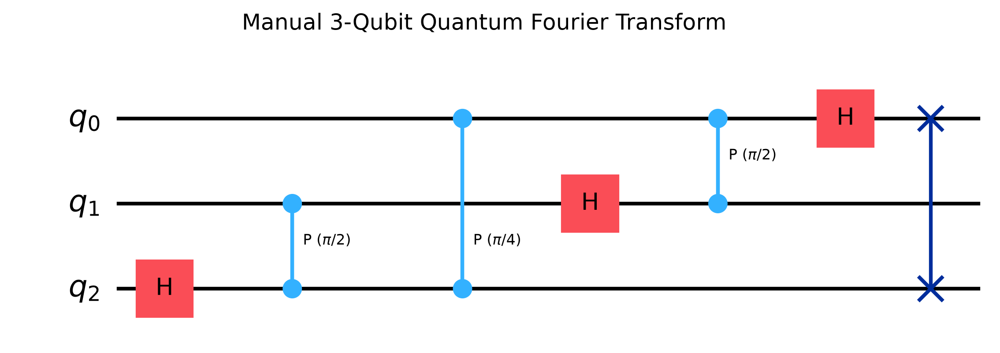
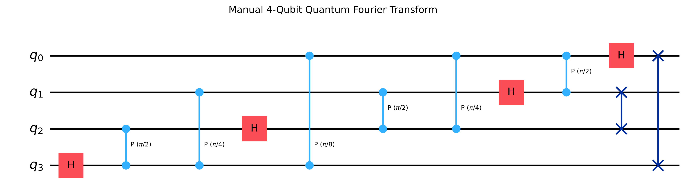
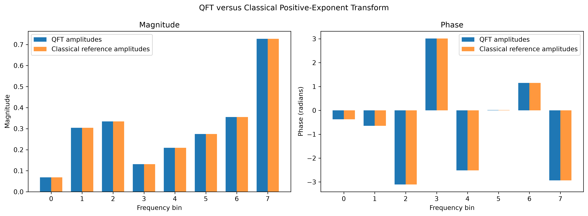
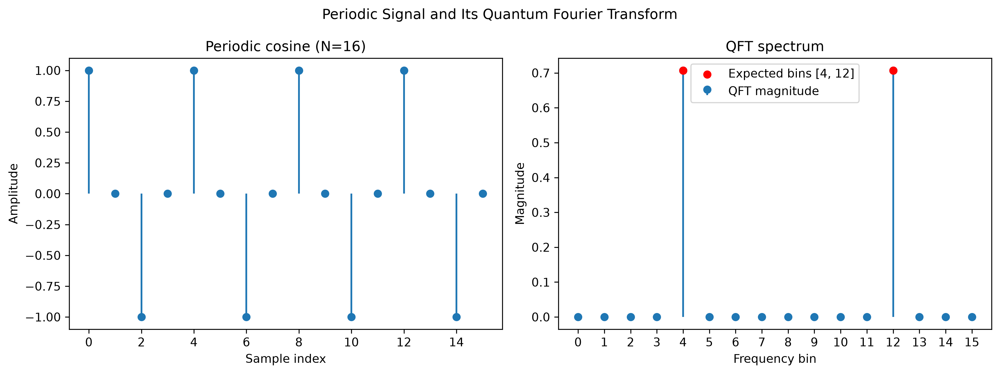
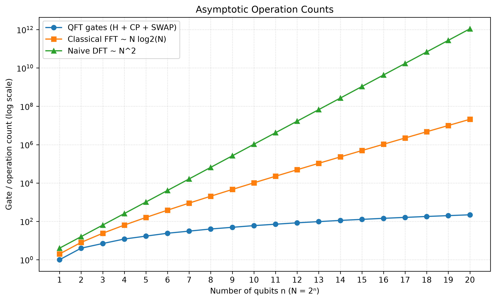
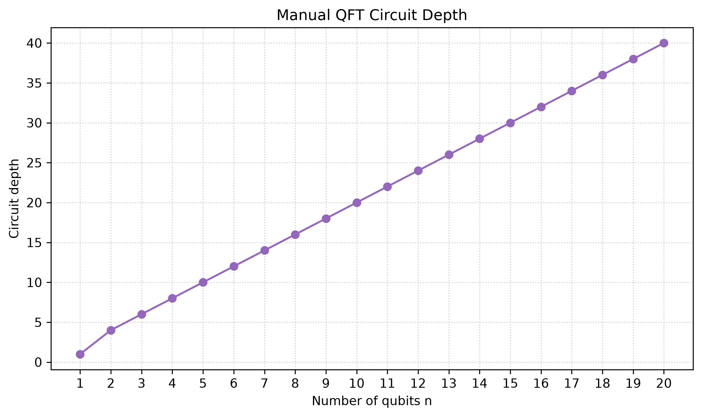
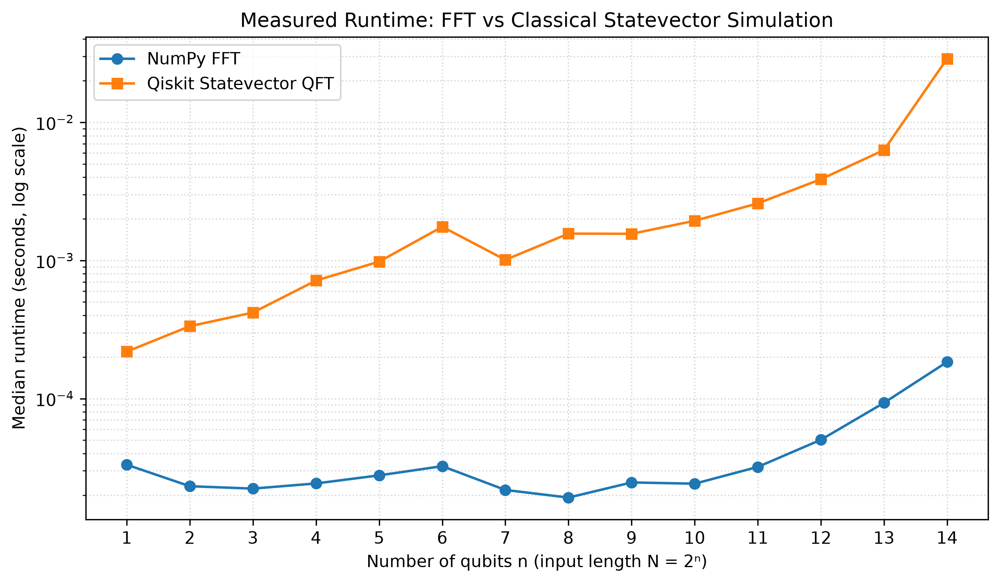
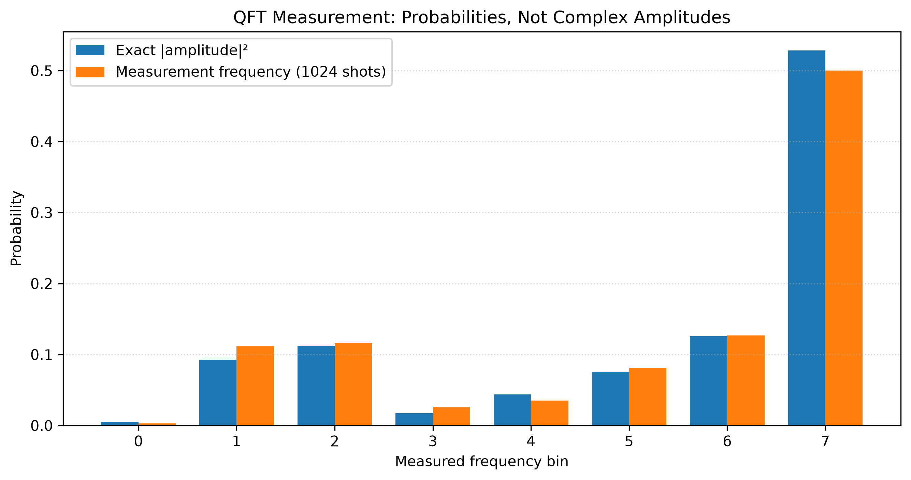

# Quantum Fourier Transform vs Classical FFT: Implementation and Comparison

This final-year project implements the Quantum Fourier Transform (QFT) by hand using Qiskit gates, checks it against classical Fourier-transform routines, and visualizes correctness, circuit structure, operation counts, runtime, and measurement outcomes. All quantum experiments use local Qiskit statevector simulation; no IBM account or cloud backend is required.

## Mathematical convention

For an input vector of length \(N=2^n\), the circuit implements

\[
\operatorname{QFT}|x\rangle =
\frac{1}{\sqrt{N}}\sum_{y=0}^{N-1} e^{+2\pi ixy/N}|y\rangle.
\]

The positive exponential is the inverse-DFT sign convention. Thus the directly comparable classical result is `np.fft.ifft(x) * np.sqrt(N)`, not `np.fft.fft(x)`. In the quantum case, input amplitudes must first be normalized (`x / np.linalg.norm(x)`); the classical reference can be applied to that same normalized vector.

## Project layout

```text
qft_vs_fft/
├── requirements.txt
├── README.md
├── src/
│   ├── quantum_qft.py
│   ├── classical_fft.py
│   ├── compare.py
│   └── plots.py
├── notebooks/
│   └── qft_vs_fft.ipynb
├── tests/
│   └── test_qft.py
└── results/
```

The manually constructed circuit applies Hadamard gates and controlled phase rotations, then swaps qubit pairs to correct bit-reversed output order. It does not use Qiskit's `QFT` or `QFTGate` library circuits. `inverse_qft(n)` is the inverse of that circuit.

## Setup on Windows with VS Code

1. Open the `qft_vs_fft` folder in VS Code.
2. Open **Terminal → New Terminal** and create/activate a virtual environment:

   ```powershell
   py -3 -m venv .venv
   .\.venv\Scripts\Activate.ps1
   ```

   If PowerShell blocks activation, use `.\.venv\Scripts\python.exe` directly or adjust the current-user execution policy according to your organization's guidance.
3. Install the project dependencies:

   ```powershell
   python -m pip install --upgrade pip
   python -m pip install -r requirements.txt
   ```
4. Open `notebooks/qft_vs_fft.ipynb`. Use the notebook's **Select Kernel** control and choose the Python interpreter in `.venv`.
5. Use **Run All** to execute the demonstration from top to bottom. Figures are written to `results/`.

No IBM Quantum account or remote simulator is involved.

## Run tests

From the project directory, with the virtual environment active:

```powershell
python -m pytest -q
```

The tests cover random normalized inputs for one through five qubits, the QFT of \(|0\rangle\), inverse composition, and unitarity.

## Results

Running the notebook generates a correctness table over four signal families (random complex, basis state, uniform superposition, and periodic cosine) for \(n=1,\ldots,5\), with a Boolean `np.allclose` result and maximum absolute error. It also creates:

















Interpret the complexity and timing figures carefully: QFT uses \(O(n^2)=O((\log N)^2)\) elementary gates for \(N=2^n\) amplitudes, while classical FFT uses \(O(N\log N)\) arithmetic operations. A quantum statevector simulator stores and updates \(N\) complex amplitudes, and measuring a QFT state reveals sampled probabilities, not its complex amplitudes. Preparing a general classical length-\(N\) vector as a quantum state can itself require \(O(N)\) resources. Therefore QFT is useful as a subroutine in algorithms such as phase estimation and Shor's algorithm, not as a drop-in replacement for a classical FFT.

## References

1. M. A. Nielsen and I. L. Chuang, *Quantum Computation and Quantum Information*, Chapter 5.
2. Qiskit documentation: [Quantum circuits](https://docs.quantum.ibm.com/api/qiskit/circuit), [Statevector](https://docs.quantum.ibm.com/api/qiskit/qiskit.quantum_info.Statevector).
3. J. W. Cooley and J. W. Tukey, “An Algorithm for the Machine Calculation of Complex Fourier Series,” *Mathematics of Computation*, 19(90), 297–301 (1965).
